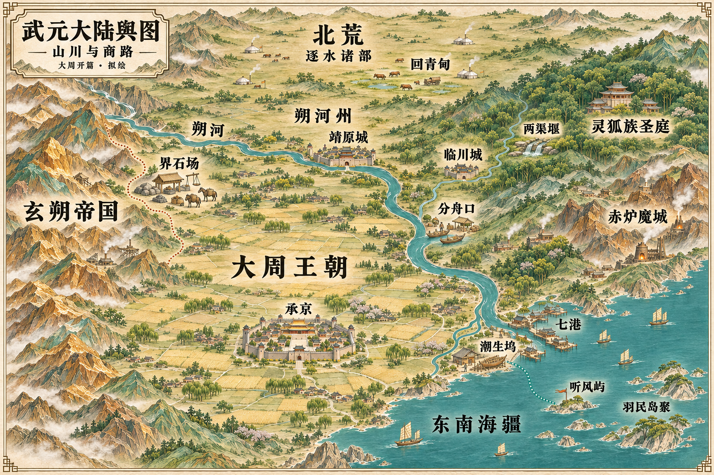
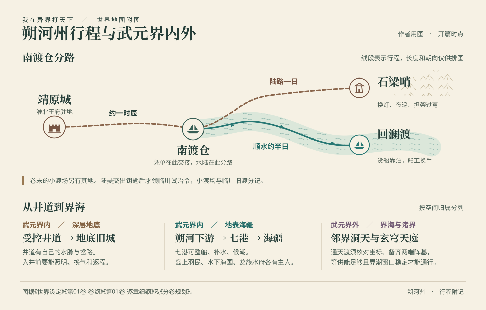

# 武元界世界地图

本页记录首卷脚程与跨界条件。山川、泊位和井道详见[商路图志](山川与商路图志.md)。

《我在异界打天下》作者用图，取大周仍在、陆昊尚未受领临川的开篇时点。总图上北下南，画到东南海疆。附图记首卷脚程和跨层通行条件。两图各用自己的尺度。

## 沿朔河读图

从靖原城登船，沿朔河往东南走。依这次拟绘的河势，船到两水相接处便有两个去向。转入山地来的支流，可以溯水到临川，换小船或卸货进山。留在大河上的船继续顺流，沿岸渐见潮滩和港埠，最后从七港一带入海。承京坐落在河道以南的中原腹地，朝廷的政令从这里发出。边军、渡仓和商船的交接，要到北边沿河各处才能看见。

| 图中位置 | 现有设定 | 本图的具体落位 |
| --- | --- | --- |
| 正北国境与西部矿带 · 玄朔帝国 | 大周自靖原向正北守的是与玄朔接壤的北关。玄朔控制的矿带向大陆西部延伸，卷四争的是矿权和边境缓冲地。 | 西侧图标标矿区。靖原西北另有雁回岭商道，盗案由淮北王府查办。北荒诸部循水草迁徙，各守自己的约。 |
| 北部 · 北荒 | 逐水诸部以水草、季节通道和贸易维生，各部自有首领。 | 草地向北延出图框，南缘与林地相接。乌铎的迁徙队可沿林缘随水草往返，营盘随季节移动。 |
| 北境 · 朔河州 | 靖原城是淮北王府驻地。临川城在朔河支流上，周围有旧渡、荒矿、旧炉和农田。 | 靖原临干流，临川在其东偏南的支流上，两城之间隔着汇流口。临川到海港要先出支流。 |
| 东部至东南山地 | 灵狐族圣庭守祖地与药圃，赤炉魔城经营火脉，万妖坊盟联结多处工坊。 | 圣庭取支流林谷，炉城取东南岩山。坊盟的工坊分散在靠山取材、出山装船的路上，以数处聚落表示。 |
| 中原 · 大周王朝 | 承京是王都，设官署、太学和神宫。陆家为大周异姓王族，驻守北境。 | 王都画在靖原以南的平原。朝廷、淮北王府与临川分处三地，便于分别写朝议、军府办差和领地经营。 |
| 朔河下游 · 东南海疆 | 下游通七港。七港商盟掌多条商路。氐人海国、龙族水府和羽民岛聚各有权属。 | “七港”标一片港群。海图先画岸线与羽民聚岛，水下城郭、龙族水府的点位留给卷五的潮路。 |

**本次拟定的行程。** 常水季由靖原装货赴临川，可以安排三日。首日顺干流，次日在汇流口候船换载，第三日溯支流到旧渡。三日包括等船装卸，是程家普通货船的一趟排期。这样，陆昊去赴任时，渡工何时来接、逾期一晚谁出工钱，都能落实到具体一程。这是本次新增的写作尺度，首卷已有的三段脚程见附图。

## 首卷从哪儿分路

| 从哪里到哪里 | 已定行程 | 对应场景 |
| --- | --- | --- |
| 靖原城 → 南渡仓 | 约一时辰 | 第4章沿凭单找船，在南渡仓查明货往石梁哨。 |
| 南渡仓 → 石梁哨 | 陆路一日 | 第4章驿骑先行，当晚值夜前送达。陆昊随护卫次日抵哨，第6章补上第二夜用的灯。 |
| 南渡仓 → 回澜渡 | 顺水约半日 | 第10章末定下次日开船，第11章留足备用运力。逆水回程须另算。 |

卷末经营的小渡场保留原稿中的称呼和独立位置。陆昊在这里修踏板、排末班船、交钥匙。卷二赴临川接收的旧渡另有渡工和欠薪。两座渡场的账与人各有来处。

## 大陆之外怎么走

- **往海里。** 七港以外仍属武元界。去羽民岛聚要能靠岸补淡水，去氐人海国要有人领走水下潮路，与龙族打交道则要认清哪片水脉归哪一支。图上的帆船只在这一层行驶。
- **往地底。** 第六卷经受控井道进入深层地底。地底族群由土龙一脉、墨鼠一族和阴月势力主导。地底旧城、井道与水脉各有走向，沿线小势力也各有辖地。第一张地下详图宜从实际进入的井口起画。临川荒矿与海底旧构件之间的线索，尚不足以定出一条直通祖城的隧道。幽冥另列。
- **往界外。** 界海是世界之间的空间。自然洞天、附属小界、独立世界和玄穹天庭所在的上层世界在这一层展开。卷六只可用两岸旧关短铃互报潮讯，卷八的新阵另经信号、空匣、载人往返三次验证。每条可用界路要各自核准两端坐标、阵基、供能、窗口和返程余量。
- **往后看政区。** 开篇图保留大周与玄朔。到卷七规划兑现，大昭才接掌原大周主体地区。玄朔、圣庭、炉城与北荒诸部仍需分别处理边界和盟约。

地名、族群与层次取自[《世界设定》](../../世界设定.md)中的“主要势力”“舞台、位置与准入”和通天渡规则。首卷行程据[卷纲](../../分卷/第01卷-卷纲.md)与[逐章细纲](../../分卷/第01卷-逐章细纲.md)。后续抵达次序据[十二卷规划](../../分卷/分卷规划.md)。山脊形状、河道弯折、海岸线、图标间距和靖原赴临川的三日船期均为拟案。
