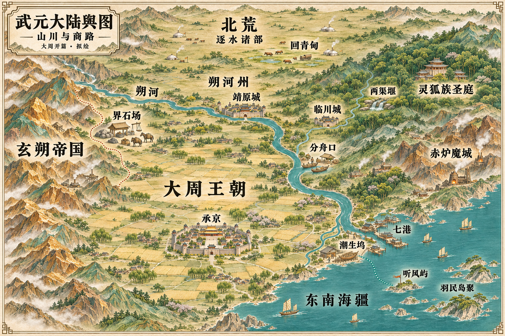
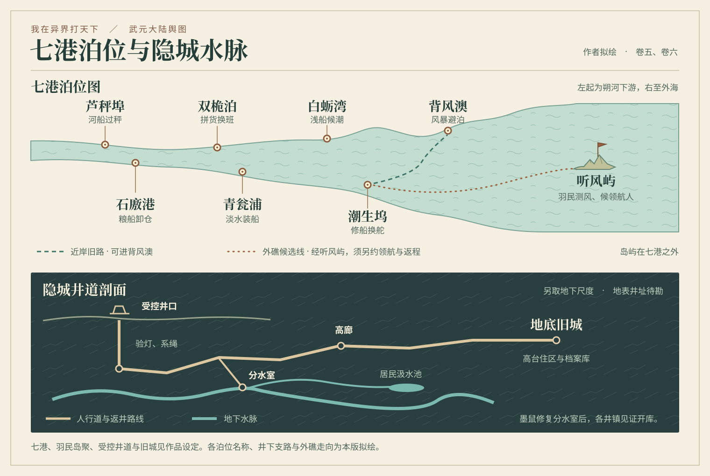

# 武元大陆舆图 · 山川与商路

大周开篇形势，作者拟案。朔河沿岸从靖原直到七港。运粮的大船顺流向海，在分舟口转进临川支流时却容易吃底。分舟口因此有了一群靠换船吃饭的人。陆昊初赴临川，最先能让这些人相信他的事，是照约付清上一趟的脚钱，让空船也有回程货。

## 沿途六处地名

| 拟名 | 在哪里，谁常来 | 写到这里时，人物面前有什么选择 |
| --- | --- | --- |
| **界石场** | 大陆西部，玄朔矿区东麓与大周北境相接的山前。矿商在场西验石，大周买家在场东过秤，两边脚户各领一程金币。修行商号收元晶，先验开采后拣净的成色、净重。 | 一批矿料退货，两边的秤砣都经得起验，争的是湿矿该在山里称还是晾干后称。卷四议停市或复市时，两国边民都有切身利害。 |
| **回青甸** | 靖原以北，草原与林地交接的浅洼。雪退后，乌铎一支先带刚产仔的母畜来啃头茬青。 | 春季牧人留出饮水道，运矿的重车绕硬地多走一程。入秋草籽落尽，原地可摆市，牧户卖皮毡、驮畜得金币，再买盐粮。谁能约定开市，由当季在场的各部决定。 |
| **分舟口** | 朔河干流与临川支流交汇处。深腹粮船在外汊卸货，浅底驳船从内汊上行。临川旧渡还在上游城边。 | 低水时分两船就得多付一次脚钱。卷二旧商号抬价，程家可以先约回程载旧炉铁件，再让驳工报出往返都能做的价。 |
| **两渠堰** | 临川上游的山溪分水处。一渠绕入灵狐药圃，一渠沿岩坡供炉户水轮与冷却池取水。万妖坊盟的匠铺在山口收修轮轴。 | 春荒水浅，药苗要在日出前浇透，炉户有一批活须赶在晚船前交付。卷三双方可试行晨间灌圃、午后蓄池，各派人读水尺。少的一份水要由谁承担，在堰边就能看出来。 |
| **潮生坞** | 七港之一，位于河口内侧，有斜船台、木料场和配舵的老师傅。临川的铁件由河船送来。 | 坞主须看潮排船台。卷五若一艘新船和漏水的归船同潮进坞，程见秋可以先把新船泊在外桩，让伤船占这一潮，再同货主重订交期。 |
| **听风屿** | 七港以外、羽民岛聚西北缘的小岛。岛上人立风标、记海雾，氐人领潮人识得礁间水路。 | 岛上蓄水只够守岛人和遇险船。走外礁的商船须在青瓮浦装足淡水，还要同羽民约风信、同氐人约进出潮时。程家可以经营一条能返航的新线。 |

## 七港为什么能结盟，也会争执

七港是七处各做一门生意的泊地。潮生坞是武元海疆的一座船坞。卷六应铃的潮生界守渡会驻在邻界，隔海航船抵达不了。粮从**石廒港**卸，水从**青瓮浦**装，坏船得把船台排到**潮生坞**。平日这几家合开一张靠泊单，货主少办几道手续。碰上连日逆风，背风澳挤满避风船，那里的人要先给船工留床位，催着放船的粮行却还得按天付仓钱。程见秋要谈新线，得找到肯替她留回航泊位的人。

近岸旧路遇风可进背风澳，浅底船也可在白蛎湾候潮。外礁线从潮生坞一带出海，到听风屿换领航人。岛外深水若涉及龙族水府的水脉，还要单独约定通行水域。图上点线是卷五可勘验的走向，开篇时程家能否拿到整季航约仍是悬念。

## 井下的人有自己的地图

越疏要陆昊先修水脉，可以让他亲眼看见理由。站在分水室里，水声很响，祖城的居民却提着空桶回来。旧槽塌了半边，水全落进低处的暗河，高处汲水池接不到水。陆昊若急着沿干渠找档案，向导就带他回井口。阴月向导带他接出断路的居民，墨鼠匠师把水引回池里，越疏再请委托存档的井镇派人开库。图中高廊通向地底旧城，深层岩庭另由土龙一脉作主。

附图给卷六留了一处可写的现场。地表井址仍待勘定，海底旧构件与临川荒矿可作互证线索。通天渡须另行核准坐标、两端阵基、供能和界潮窗口，沿井道只能抵达武元界内的地底。

## 用图时的脚程和权属

- **已定。** 靖原城在朔河州，临川城在朔河支流，承京在中原，玄朔与大周正北接壤，其矿区向西延伸。雁回岭在靖原西北，过岭商队有时须等王府护送。大周仍在，临川尚待授予试治。卷七建立大昭是后续规划。[世界设定](../../世界设定.md) · [十二卷规划](../../分卷/分卷规划.md)
- **首卷脚程。** 靖原城至南渡仓约一时辰。由仓顺水到回澜渡约半日，改走陆路到石梁哨用一日。南渡仓、回澜渡和卷末小渡场沿用原有位置关系。靖原至临川的普通货船排三日，含分舟口换载。[首卷行程图](朔河州行程与界域示意.svg) · [首卷脚程与界域](世界地图说明.md)
- **本版拟案。** 六处新地名、七港的分工与泊位、旱季用水时段、外礁线和地底剖面供作者选用。港群位置、水陆已知层次取自现有设定。七港以外各族对具体港口、井口和水道的权利，随卷内协议落实。

## 从《张三丰异界游》借来的地理思路

| 原作里实际发生的事 | 在武元界重建的地方 |
| --- | --- |
| 第七十节《未来发展》提出招徕多族交易，第七十一节《半年成果》写出订约、开店、人货进城和商队竞争。商路繁荣之后，领主也没能独占交易。 | 在分舟口，程家有船，驳工有本地运力，炉户才有回程货。能调动三家的货与船，临川旧渡才养得起常班。[原文](../../../张三丰异界游.txt#L3654) · [对应笔记](../../../../analyses/张三丰异界游/notes/segment-019.md) |
| 第三百八十节《事情始末》说到地底居民已有河船贸易，想把既有水路延伸到另一方，还得解决借道。 | 地底剖面把人行高廊和居民水脉画成两条线。修渠要同墨鼠匠师议定，通暗道由阴月派人，开库须有存档井镇作见证。[原文](../../../张三丰异界游.txt#L20103) |
| 第四百三十六节《组建海军》把内陆工匠、已有船只和坞内半成品接到一起，随即遇到专业人手的缺口。 | 潮生坞能把临川铁件装到海船上。等潮占台、配舵、补水和领航分别掌握在不同的人手里。卷五出海仍然用得到卷二结识的匠人。[原文](../../../张三丰异界游.txt#L23458) |
